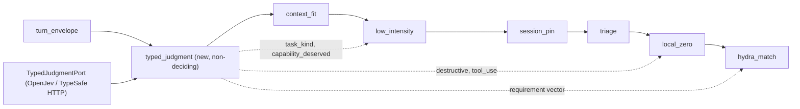

## Summary

Add opt-in **typed-judgment** routing signals from a Jev-compatible "System One" decision server ([TypeSafe Jev](https://jevmodel.org) wire API; self-hosted via [OpenJev](https://github.com/razorback16/openjev)). One request per user-prompt turn asks a small set of typed questions (choice / score / yes-no probability) about the turn and returns calibrated model probabilities. Those answers feed the existing pipeline as tier hints, gates, and an alternative HyDRA requirement source.

**Principle (borrowed from [pi-jev-model-router](https://github.com/da-vinci-noob/pi-jev-model-router)):** the judge reads the *task*; code owns budget, cache economics, context fit, and the final model choice. The judge never sees spend or price.

## Priority

P1

## Why

Several open and past issues are semantic-classification problems we have patched with keyword lists, regexes, or an embedding projection that is still honest-untrained:

- #179 — terse continuation prompt in a deep session scored like a trivial turn (HyDRA picked `glm-5.3-flash`).
- #97 / #98 — repo cleanup routed to local zero-tier; fixed with `COMPLEX_KEYWORDS` additions (`'clean up'`, `'cleanup'`) and a cue-count step function.
- #23 — planning detection via `PLANNING_PATTERNS` regex.
- #110 / #96 / #167 / #173 — months of encoder / projection / calibration work; v1.1 comment on #110: "HyDRA remains honest-untrained".

## Evidence (local OpenJev `openjev-0.1`, DiffusionGemma 26B-A4B, MLX on Apple silicon, 2026-10-01)

Incident replays (scores 0–3, probabilities 0–1):

| Case | Result |
|------|--------|
| #97 "Help me clean up the repo" turn 1 | destructive 1.00, tool_use 2.0/3, small-model-OK 0.24 (with full question set) |
| #23 planning prompt in pinned economical session | task_kind `plan` (confidence 1.00), capability_deserved 2.0/3 |
| Subtle websocket double-delivery bug | task_kind `debug` (0.99), capability 2.0/3, deep reasoning 1.00 |
| Trivial indentation fix / "thanks!" | capability_deserved 0.02 / 0.00 |
| #132 "Build finished: no errors" vs "HTTP 429 Rate limit exceeded" | failed 0.00 vs 0.998 |
| #180 fake `Cursor shell: …` command as text | prose-command 1.00 (normal prose 0.17) |
| #181 repeating `sleep` loop | degenerate **0.00 (missed)** — keep deterministic check |
| #179 deep-session "Quotas has been reset, continue" | **rated mid-tier by every question set** unless the state carried a workspace/stakes description — judge alone does not fix #179 |

Findings that shape the design:

1. **A single isolated yes/no question was unstable** (`small_model_ok` gave 0.89 on a planning prompt when asked alone). Questions with anchored level descriptions (pi-jev's `capability_deserved` rubric) were stable, and OpenJev reads all answer slots jointly, so a coherent question set improves each answer.
2. **State must be readable.** The HyDRA flag prefix (`[turns:12000|tools:1|…] text`) produced the same under-rating as HyDRA. Named JSON fields plus a short activity excerpt worked.
3. **`complexity` and `capability_deserved` agreed in every case** — candidate for removal (measured in the eval child).

Latency (fresh states, `samples: 1`, this Mac):

| Request | Mean |
|---------|------|
| 3 short questions, short state | ~385 ms |
| 3 questions + activity excerpt | ~494 ms |
| pi-jev 4 questions (long rubrics) | ~832 ms |
| 7 questions | ~991 ms |
| ~3k-token state | 3.6–4.3 s |
| OpenJev README, NVIDIA GPU (vLLM) | 27–31 ms |

HyDRA stage budget is ~80–120 ms, so the judge runs **only on user-prompt turns** (never `tool_result`), with a hard timeout and fail-open.

## Design

- Question set: `task_kind`, `capability_deserved`, `needs_deep_reasoning`, `code_gen`, `tool_use`, `destructive`.
- Not ported from pi-jev: its demand formula, per-kind model chains (HyDRA + expected cost already choose models), and budget fields in the judge state.
- Default off. Local OpenJev endpoint by default; hosted TypeSafe / Codiv only with explicit `allow_remote` opt-in.

## Children

### Sprint 1 — typed judgment foundation

- [ ] {{T1}} — TypedJudgmentPort + Jev-compatible HTTP adapter
- [ ] {{T2}} — readable routing state + six-question schema
- [ ] {{T3}} — hydra-input loop flag substring grep (follow-on #132)
- [ ] #179 — deterministic session-depth floor + flash-class exclusion (scope narrowed; see comment)

### Sprint 2 — consumers + eval

- [ ] {{T4}} — `typed_judgment` pipeline stage
- [ ] {{T5}} — tier hints and `local_zero` gates
- [ ] {{T6}} — typed judgment as HyDRA requirement source
- [ ] {{T7}} — adaptive reasoning uses `needs_deep_reasoning`
- [ ] {{T8}} — eval comparison + latency benchmark (decision artifact)

## Out of scope

- Flipping any default (encoder, requirement source, frugality) — decided after {{T8}} with operator approval.
- FrugalGPT generate-then-judge cascades — the judge is pre-generation only.
- #181 degenerate-output detection (deterministic), #180 replay repair, #175–#178.

## Related

#179, #97, #98, #23, #110, #96, #167, #173, #166, #112, #169, #181
